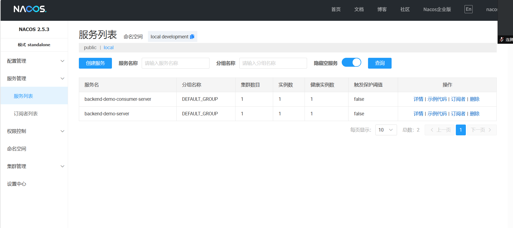

<p align="center">
  
</p>

# 订单管理服务

本工程包含订单服务 A 和订单调用服务 B。A 提供订单 CRUD、分页、参数校验和
Liquibase 数据库变更；B 通过 Nacos 服务发现和 OpenFeign 调用 A。

## 模块

| 模块 | 作用 |
| --- | --- |
| `backend-demo-api` | 订单 DTO、VO、枚举、错误码和接口契约 |
| `backend-demo-context` | 订单领域服务、Repository、Liquibase |
| `backend-demo-starter` | A 的 Controller 和自动装配 |
| `backend-demo-feign-starter` | A 的 Feign Client 与调用适配 |
| `backend-demo-server` | A 服务，端口 `8081` |
| `backend-demo-consumer-server` | B 服务，端口 `8082` |

## 环境要求

- JDK 17
- Maven 3.9+
- MySQL 8.0+
- Nacos 2.5.3

Nacos `local` 命名空间需要提前创建。数据库账号、Nacos 账号和密码只通过环境变量
提供，不写入源码或配置。

```powershell
$env:NACOS_ADDR = "127.0.0.1:8848"
$env:NACOS_NAMESPACE = "local"
$env:NACOS_USERNAME = "<nacos-user>"
$env:NACOS_PASSWORD = "<nacos-password>"

$env:DB_URL = "jdbc:mysql://127.0.0.1:3306/java_simulation_project?useUnicode=true&characterEncoding=utf8&useSSL=false&allowPublicKeyRetrieval=true&serverTimezone=Asia/Shanghai"
$env:DB_USERNAME = "<database-user>"
$env:DB_PASSWORD = "<database-password>"
```

创建数据库：

```sql
CREATE DATABASE IF NOT EXISTS java_simulation_project
  CHARACTER SET utf8mb4
  COLLATE utf8mb4_0900_ai_ci;
```

## 构建和测试

```powershell
mvn clean test
mvn clean package
```

测试覆盖订单创建成功、重复订单号、数据库唯一冲突、查询缺失、修改缺失、删除、
分页空结果、正常分页、参数校验及 Feign 错误传递。

## 启动顺序

1. 启动 Nacos。
2. 启动 MySQL。
3. 启动 A 服务。
4. 启动 B 服务。

```powershell
java -jar backend-demo-server/target/backend-demo-server-0.0.1-SNAPSHOT.jar
java -jar backend-demo-consumer-server/target/backend-demo-consumer-server-0.0.1-SNAPSHOT.jar
```

服务名：

- A：`backend-demo-server`
- B：`backend-demo-consumer-server`

## JAR 打包与双击部署

双击项目根目录的 `build-deploy.bat`，构建脚本会把两个可执行 JAR 放到
`deploy/`，并统一命名为：

- `backend-demo-server.jar`
- `backend-demo-consumer-server.jar`

之后分别双击 `deploy/start-a.bat`、`deploy/start-b.bat`，或直接双击
`deploy/start-all.bat`。详细说明见
[docs/jar-deployment-guide.md](docs/jar-deployment-guide.md)。

## 数据库变更

入口文件为 `backend-demo-liquibase-master.xml`。每次启动 A 时由 Liquibase 自动执行：

- `v1.0.0.xml`：基础 Demo 表。
- `v1.1.0.xml`：订单表、订单号唯一约束、分页/筛选索引和 3 条合成测试数据。
- `v1.2.0.xml`：将客户、状态筛选索引调整为覆盖分页排序的联合索引。

订单分页固定按 `created_time DESC, id DESC` 排序。索引
`idx_backend_demo_order_created(created_time, id)` 用于分页排序，
`idx_backend_demo_order_filter_page(customer_id, status, created_time, id)` 用于
客户和状态筛选后的稳定排序。

## 接口

| 方法 | 路径 | 说明 |
| --- | --- | --- |
| `GET` | `/demo/hello?name=World` | 验证 Controller → Service 请求链路 |
| `POST` | `/orders` | 创建订单 |
| `GET` | `/orders/{id}` | 订单详情 |
| `GET` | `/orders?current=1&pageSize=20` | 分页查询 |
| `PUT` | `/orders/{id}` | 完整修改 |
| `DELETE` | `/orders/{id}` | 物理删除 |
| `GET` | `/consumer/orders/{id}` | B 调用 A 查询详情 |
| `GET` | `/consumer/orders?current=1&pageSize=20` | B 调用 A 分页查询 |

分页参数 `current` 从 1 开始，`pageSize` 范围为 1 到 100。订单状态只允许
`CREATED`、`PAID`、`CANCELLED`。重复删除返回订单不存在。

完整契约见 [docs/order-api.md](docs/order-api.md)。

## 接口文档和回归

- Swagger UI：`http://127.0.0.1:8081/swagger-ui.html`
- OpenAPI JSON：`http://127.0.0.1:8081/v3/api-docs`
- Postman 集合：`postman/order-management.postman_collection.json`
- 验证脚本：`scripts/verify-order-api.ps1`
- 联调记录：`docs/evidence/api-verification.md`
- JUnit 结果：`docs/evidence/junit-test-results.md`
- 架构与 Postman 操作指南：`docs/architecture-and-postman-guide.md`

Postman 集合中的 `aBaseUrl` 和 `bBaseUrl` 默认为本机地址，可按环境修改。

## A/B 调用说明

B 的 Feign Client 只配置服务名 `backend-demo-server`，不配置 A 的主机地址。
请求由 Spring Cloud LoadBalancer 从 Nacos 获取 A 实例后发出。B 不访问 A 的数据库。
